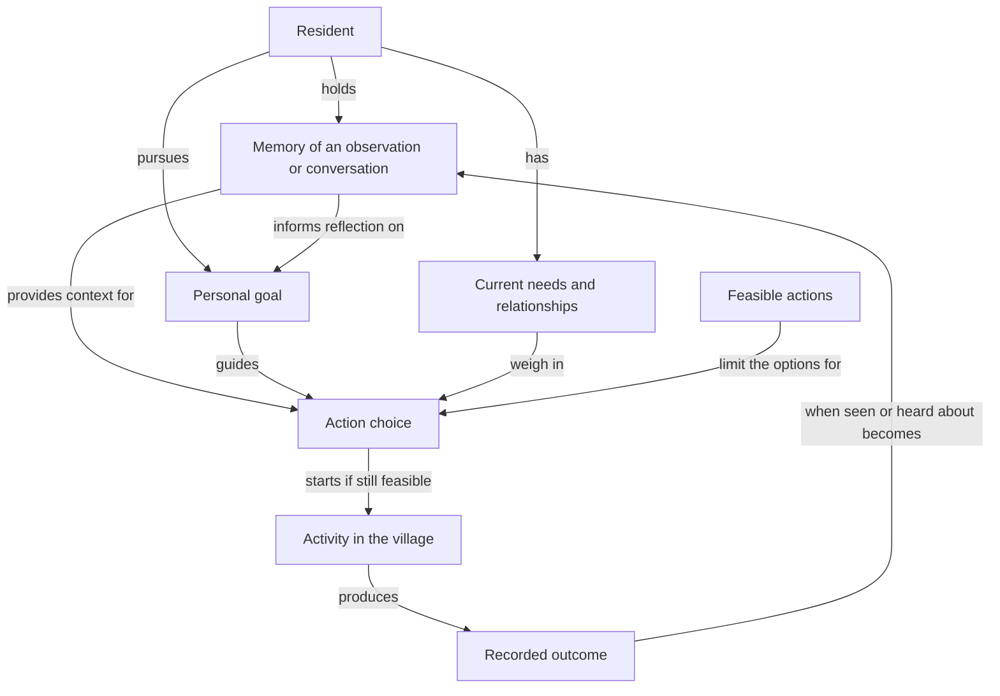

# Resident knowledge graph

**Accepted design baseline · 21 November 2026.** A general-purpose model helps each resident form and revise personal goals. The Decisions API chooses the resident’s next feasible action in light of those goals. The simulation executes that action and establishes what happened. The roles stay the same if the project changes models. PostgreSQL holds the records that connect them.

## What connects to what

An event belongs to the world. A memory belongs to the resident who witnessed it or heard an account of it. Record the event, the source and when the resident learned about it. Two people can leave the same encounter with different beliefs. A promise also connects its parties and keeps its own terms and status. Choosing lunch can postpone work on a promise while leaving it open.

## Who decides and when

| Responsibility | Trigger and decision | What carries forward |
| --- | --- | --- |
| **Form goals** · general-purpose model | A resident needs direction, fulfills a goal, or learns something consequential. Consider their identity, relationships, commitments and relevant memories. Keep, revise or retire a goal, or form a new one. | A goal version records whose goal it is, the evidence behind it and what would count as progress. The same goal can guide several activities over several days. |
| **Choose an action** · Decisions API | At an activity boundary the engine checks for a still-valid standing instruction from an earlier choice. A new tradeoff or an uncovered routine goes to the Decisions API, which weighs the resident's needs and knowledge and selects a feasible option. | An activity records whether it started from a fresh choice or a standing instruction and links to the exchange behind it. Versioned goals will join this chain in Stage 2. |
| **Resolve the outcome** · simulation engine | Check that the choice is still feasible. Move the resident, advance time and apply material or social effects when their conditions are met. If the choice becomes impossible, record the obstacle and return the next choice to the model. | A dated outcome records what changed, where and for whom. Witnesses can remember it. A consequential outcome can prompt another goal review. |

Goal reviews cost a model call. Reuse the last valid goals between reviews, including when the goal-setting model is unavailable. Reserve action calls for choices such as whether to visit a friend or draw water. The walk to the well and the work of filling a bucket are phases of the chosen task.

## Alice and Edith

This example illustrates the baseline. Suppose Alice learns that sleeping through a promised meeting left Edith waiting. Her goal-setting model could form the goal *“I want Edith to feel she can count on me again.”* Alice wakes hungry. Given that goal and the choices available, the Decisions API might select breakfast first and a visit to the well afterward. The goal survives breakfast.

If Edith has already left, the engine records Alice’s arrival and the missed visit. Finding the well empty gives Alice new evidence. Only a later interaction with Edith could tell Alice how Edith felt about the effort. A viewer tracing the episode should be able to distinguish the goal Alice held, the visit she chose and what the visit accomplished.

## Where the implementation stands

**Implemented today.** Resident JSONB records contain predefined goals, needs, relationships, memories and the current activity. In OpenAI mode, `gpt-6-luna` receives a feasible menu and the two latest memory texts. The engine validates the returned choice and applies it. PostgreSQL keeps the exact action request and reply, reported confidence and subsequent steps in the private trace. [Request builder](../decisions.mjs) · [Action application](../action-turns.mjs) · [Trace schema and queries](decision-tracing.md)

**Goal reviews in Stage 2.** Add general-purpose goal reviews, versioned goals linked to the resident’s evidence, and retrieval of the memories that matter to the current choice. Link each goal-setting exchange to its goal versions, and each action exchange to the versions it received. An operator should be able to follow a resident from a source event through a goal revision to a selected action and its outcome in PostgreSQL, without replaying the village. The initial model choices are the project’s lower-cost Claude model for reflection and Luna for action selection. [Model choices and current behavior](design.md)

**Order of work.** Stage 0 is live. The promise pilot adds observable work outcomes, local knowledge and commitments. General-purpose goal reviews follow in Stage 2. [Canonical roadmap](roadmap.md)
